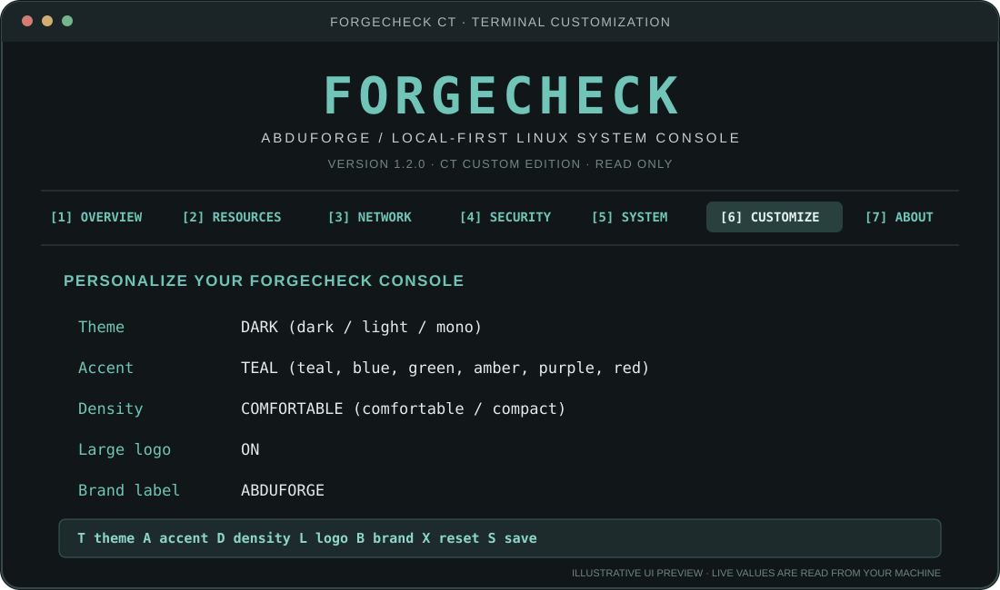

<div align="center">

# FORGECHECK

**CT · Custom Terminal Edition**

`CUSTOMIZABLE TUI` · `LINUX SYSTEM INVENTORY` · `PYTHON`

*Make the console yours. Keep the system untouched.*

**Version 1.2.0**

</div>

---

ForgeCheck is a lightweight, keyboard-driven Linux terminal dashboard for viewing a local system snapshot. **CT (Custom Terminal)** adds saved interface preferences: dark, light or monochrome themes; six accent colors; compact or comfortable layout; a large wordmark toggle; and a personal brand label.

The project is designed to stay dependency-free, understandable, and usable on modest Linux hardware.



*Illustrative preview of the Customize page. Live system values are collected on the user's own machine.*

## CT customization

Open the dashboard and press `6` or `C` to open **CUSTOMIZE**. Preferences are saved automatically to `~/.config/forgecheck/config.json` (or `$XDG_CONFIG_HOME/forgecheck/config.json`) with owner-only file permissions. The file is local and is not included in exported reports.

| Key | Setting | Options |
|:--|:--|:--|
| `T` | Theme | `dark`, `light`, `mono` |
| `A` | Accent | `teal`, `blue`, `green`, `amber`, `purple`, `red` |
| `D` | Density | `comfortable`, `compact` |
| `L` | Large wordmark | on / off |
| `B` | Brand label | custom safe ASCII label, up to 28 characters |
| `X` | Reset | restore saved defaults |
| `S` | Save | save preferences immediately |

The selected theme and accent are rendered with terminal colors when the terminal supports them. Monochrome mode respects the terminal's default colors. Compact density uses a shorter header to leave more room for the dashboard.

### Manual configuration

Example `~/.config/forgecheck/config.json`:

```json
{
  "theme": "dark",
  "accent": "teal",
  "density": "comfortable",
  "show_logo": true,
  "brand": "ABDUFORGE"
}
```

Reset preferences from the shell:

```bash
forgecheck --reset-customization
```

Print the configuration path:

```bash
forgecheck --config-path
```

## Dashboard pages

1. **Overview** — system identity and compact resource summary.
2. **Resources** — RAM, swap, root disk, CPU sample and battery.
3. **Network** — local interface addresses and listening sockets.
4. **Security** — local UFW, OpenSSH package and Secure Boot inventory.
5. **System** — CPU frequency, temperature, runtime and load.
6. **Customize** — themes, accents, density, wordmark and brand label.
7. **About** — project scope and design principles.

## Features

- Original large block-letter `FORGECHECK` wordmark.
- Persistent personal UI preferences stored locally.
- Local snapshot of distribution, kernel, architecture, CPU, Python, RAM, swap, filesystems, uptime, load average, battery, temperature and frequency when available.
- Local-only network inventory. It lists this machine's interface addresses and listening sockets; it does not probe remote machines.
- Basic local inventory for UFW, the Debian `openssh-server` package and Secure Boot state when readable.
- Timestamped JSON and Markdown report exports.
- Python standard library only; no third-party runtime dependencies.

## Requirements

- Linux and Python 3.10 or newer.
- A UTF-8 terminal for the block-letter artwork.
- `curses` (normally included with Python on Linux distributions).
- Optional `ip` and `ss` commands from `iproute2` for network inventory.
- Optional `ufw`, `dpkg-query`, and UEFI efivars for their respective inventory rows.
- Optional `konsole` for the KDE application-menu launcher.

## Run from source

```bash
chmod +x forgecheck.py
./forgecheck.py
```

Classic one-shot output:

```bash
./forgecheck.py --classic
```

JSON output:

```bash
./forgecheck.py --json
```

Write a Markdown report:

```bash
./forgecheck.py --report ~/forgecheck-report.md
```

Open the interactive dashboard explicitly:

```bash
./forgecheck.py --dashboard
```

## Dashboard keys

| Key | Action |
|:--|:--|
| `1`–`7` | Open Overview, Resources, Network, Security, System, Customize or About |
| `←` / `→` | Previous / next page |
| `C` | Jump to Customize |
| `T/A/D/L/B` | Change theme, accent, density, logo or brand on Customize page |
| `X` | Restore default UI preferences |
| `S` | Save UI preferences |
| `R` | Refresh local snapshot |
| `J` | Export JSON |
| `M` | Export Markdown |
| `H` or `?` | Keyboard help |
| `Q` or `Esc` | Quit |

## Install for the current user

No administrator privileges are required. From the project directory:

```bash
./install.sh
```

The installer places the command in `~/.local/bin/forgecheck`, installs the icon, and creates a KDE application-menu entry named **ForgeCheck CT Console**. On KDE systems with Konsole installed, that launcher opens a separate full-screen terminal window.

Uninstall the user-local command and launcher:

```bash
./uninstall.sh
```

Your customization file and exported reports are kept when uninstalling.

## Safety, scope and privacy

ForgeCheck is a **read-only local inventory**, not a vulnerability scanner or penetration-testing framework. Network information is limited to local interface addresses and local listening sockets. It does not probe remote machines, send network scans, exploit services, start or stop services, change firewall rules, or modify system configuration. It does not claim that a machine is secure.

Run it as a regular user. Some optional checks may say that status is unavailable when elevated permission would be required. That is intentional: ForgeCheck does not request `sudo` or prompt for a password.

JSON and Markdown reports can contain private LAN IP addresses and listening-port details. Review reports before sharing. UI preferences are stored locally and are not uploaded by ForgeCheck.

## Development and tests

```bash
python3 -m py_compile forgecheck.py
python3 -m unittest discover -s tests -v
```

The test suite uses only the Python standard library.

## Project

- Version: `1.2.0`
- Codename: `CT` (Custom Terminal)
- License: MIT
- Author: Abduali / AbduForge

*Every system tells a story. Learn to read it.*
